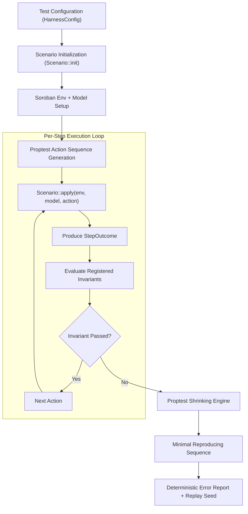

# Architecture and Design Specification

`soroban-invariants` provides property-based and model-based invariant testing infrastructure for smart contracts built on Stellar's Soroban platform. It marries the property generation and shrinking engine of `proptest` with the execution and state-inspection capabilities of `soroban-sdk::Env` testutils.

---

## High-Level Architecture

The testing lifecycle proceeds according to the following state-transition pipeline:



---

## Core Modules

### 1. Strategies (`src/strategies/`)
Provides generators tailored to Soroban data types and smart contract workflows:
- **`bounded_amount(min, max)`**: Produces positive `i128` values within bounded intervals to test liquidity ranges, dust values, overflow boundaries, and precision edge cases.
- **`timestamp_sequence(min_ts, max_steps, max_jump)`**: Generates monotonically non-decreasing sequences of `u64` Unix timestamps, modeling forward ledger time progression without accidental time-travel.
- **`address_pool(env, count)`**: Instantiates a fixed pool of valid `Address` accounts (using `Address::generate(env)`). Choosing actors from a small pool (e.g. 3–5 addresses) forces contracts to experience realistic multi-party interactions and concurrent state collisions.
- **`symbol_pool(env, names)`**: Generates `Symbol` instances from a controlled set of identifiers for deterministic token IDs, roles, or key lookups.
- **`vesting_schedules(options)`**: Generates structured `Vec<(u64, i128)>` schedules with configurable flags for sorted order, unsorted order, and duplicate timestamp handling.

### 2. Model-Based Harness (`src/harness/`)
The harness formalizes stateful property testing through the `Scenario` trait:

```rust
pub trait Scenario: Sized {
    type Action: core::fmt::Debug + Clone;
    type Model;

    /// Initialize the Soroban environment, contract, and abstract reference model.
    fn init(env: &soroban_sdk::Env) -> (Self, Self::Model);

    /// Generate actions using proptest.
    fn strategy() -> impl proptest::strategy::Strategy<Value = Self::Action>;

    /// Apply an action to both the smart contract and the abstract model,
    /// returning a StepOutcome.
    fn apply(
        &mut self,
        env: &soroban_sdk::Env,
        model: &mut Self::Model,
        action: &Self::Action,
    ) -> StepOutcome;
}
```

- **`StepOutcome`**: Encapsulates whether a contract call succeeded or failed with an expected/unexpected Soroban error (`Result<(), E>`). This enables negative testing (verifying that unauthorized or invalid calls reliably fail) alongside positive progress.
- **`run_scenario::<S>(config)`**: Executes the test suite over hundreds of generated sequences. On any invariant failure or model discrepancy, it drives `proptest` shrinking to produce a minimal reproducible action trace.
- **Deterministic Replay**: Generates and prints the exact PRNG seed upon failure. Supplying `HarnessConfig::with_seed(seed)` reproduces the exact failure trace deterministically.

### 3. Invariant Helpers (`src/invariants/`)
Built-in, composable invariant checks that can be asserted after any action step or embedded into scenario loops:
- **`token_conservation`**: Asserts that the sum of balances across all accounts and contract pools remains constant (or matches expected minted/burned deltas).
- **`non_negative_balances`**: Asserts that no account balance dips below zero.
- **`monotonic_ledger_time`**: Verifies that the ledger timestamp never moves backwards.
- **`requires_auth`**: Uses `env.mock_auths()` and `env.auths()` to verify that privileged calls fail when unauthorized or when signed by an unauthorized identity.
- **`sorted_by_key`**: Validates that returned vectors (schedules, queues, priority lists) remain sorted under arbitrary insert and removal sequences.
- **`sum_matches`**: Asserts that aggregated contract totals match the sum of component allocations.

---

## Error Reporting and Shrinking

When an invariant fails:
1. The harness captures the failing action index, the invariant name, and the model vs. contract discrepancy.
2. `proptest` shrinks the action list (e.g. from 80 random operations down to 2 operations: `[Deposit(10), MalformedClaim(10)]`).
3. The harness formats the minimized sequence into an unambiguous, copy-pasteable report containing:
   - Initial conditions.
   - Minimal action trace.
   - Expected vs. actual values.
   - Seed for deterministic replay.
